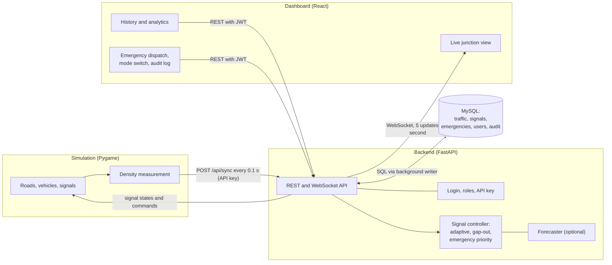
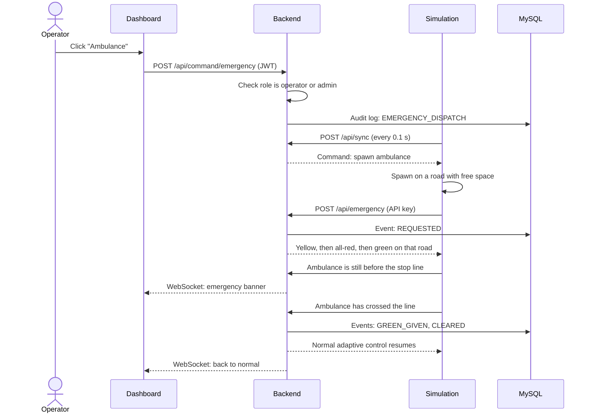
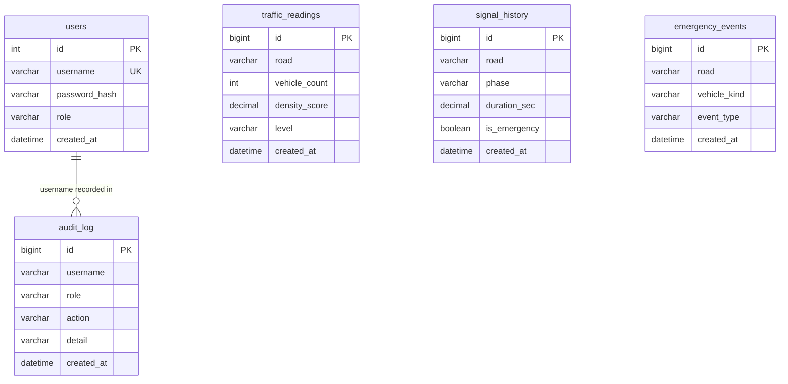

# SmartFlow: Adaptive Traffic and Emergency Vehicle Management

**GEC Hackathon 2026, Problem Statement 03:** Smart City, Adaptive Traffic and Emergency Vehicle Management System

SmartFlow is a software simulation of a smart-city intersection. It measures traffic density on each road, adjusts green times automatically, and gives safe priority to ambulances, fire trucks and police vehicles. A live dashboard shows the junction, and a MySQL database stores traffic readings, signal changes and emergency events for reports.

No real traffic lights, cameras or hardware are used. Everything runs as software on one computer.

---

## Table of contents

1. [Problem and solution](#1-problem-and-solution)
2. [Features](#2-features)
3. [Technology](#3-technology)
4. [System architecture](#4-system-architecture)
5. [Folder structure](#5-folder-structure)
6. [Setup (Windows, PowerShell)](#6-setup-windows-powershell)
7. [Running the project](#7-running-the-project)
8. [Using SmartFlow](#8-using-smartflow)
9. [How it works](#9-how-it-works)
10. [Database design](#10-database-design)
11. [API reference](#11-api-reference)
12. [Security](#12-security)
13. [Testing](#13-testing)
14. [Benchmark results](#14-benchmark-results)
15. [Design decisions](#15-design-decisions)
16. [Limitations](#16-limitations)
17. [Troubleshooting](#17-troubleshooting)
18. [Future work](#18-future-work)
19. [Team](#19-team)

---

## 1. Problem and solution

**Problem.** Fixed-timer traffic signals give every road the same green time, whether it is empty or jammed. They also cannot react when an ambulance approaches. Both waste time, and the second can cost lives.

**Solution.** SmartFlow watches the traffic on every road and decides how long each signal stays green. When an emergency vehicle is on its way, it changes the signals so the vehicle gets a green, and it does this without ever showing two roads a green light at the same time.

**Scope.** One four-way junction (North, East, South, West), left-hand traffic as in India, straight movement only (no turns).

### Problem statement coverage

| Requirement | How SmartFlow meets it |
|---|---|
| Simulate roads, vehicles, signals and junctions | Pygame junction with cars, bikes, buses, trucks, queues and stop lines |
| Detect traffic density | Weighted vehicle score near each stop line, classified LOW, MEDIUM or HIGH |
| Adjust signal timing automatically | Adaptive green time with early termination once the queue clears |
| Give priority to emergency vehicles | Ambulance, fire truck and police priority with a safe signal transition |
| Change signals safely | One road green at a time, and Yellow and All-Red are never skipped |
| Live dashboard | React dashboard fed by a WebSocket |
| Store traffic, emergency and signal history | MySQL with five tables |
| Basic reports and analytics | History tab with charts and tables |
| AI and automation | Automatic control, recovery after failures, and an optional forecasting mode |
| Data modelling | Relational schema with indexes and analytics queries |
| API and component communication | REST, WebSocket and a command channel between the dashboard and the simulation |
| Event processing | Emergency lifecycle events and state-change detection |
| Synchronous and asynchronous workflows | Async endpoints, background threads and a database write queue |
| Security and access control | Login, roles, API key and audit log |

---

## 2. Features

- **Junction simulation.** Four roads, four vehicle types (car, bike, bus, truck) and three emergency types. Vehicles queue at stop lines and keep a safe gap.
- **Traffic density.** Each vehicle within 300 px of a stop line is counted using a weight (bike 0.5, car 1, truck 2, bus 2). The total is the density score.
- **Adaptive signals with gap-out.** Green time is 6 to 20 seconds based on density, and a green ends early once the road's queue has cleared. No road can wait forever.
- **Emergency priority.** The current green ends with a normal yellow, then all-red, then the emergency road gets green until the vehicle has crossed. Normal control then resumes.
- **Three control modes.** Fixed timer, adaptive (default) and predictive. An admin can switch between them live.
- **Short-term forecasting.** Holt's exponential smoothing predicts each road's density 10 seconds ahead. See the benchmark section for how it performed.
- **Live dashboard.** Junction diagram with glowing signal heads, countdown, queue bars, density levels, forecasts, emergency alerts and an event feed.
- **History and analytics.** Traffic trend line chart, level distribution chart, average green time per road, emergency response time, and tables of recent signal and emergency events.
- **Security.** Login with three roles, a simulation API key, login lockout and an audit log.
- **Resilience.** If the backend is unreachable, every signal in the simulation turns red. If MySQL stops, the signals and dashboard keep working.
- **Automated tests.** 100+ pytest tests, including randomised 20-minute safety runs for every control mode.

---

## 3. Technology

| Part | Technology |
|---|---|
| Simulation | Python 3.11, Pygame |
| Backend | FastAPI, Uvicorn, SQLAlchemy, PyMySQL, PyJWT |
| Database | MySQL 8 |
| Frontend | React (Vite), Recharts |
| Communication | REST API and WebSocket |
| Testing | pytest, httpx |
| Development | VS Code, Windows PowerShell |

---

## 4. System architecture



**The backend is the only decision maker.** The simulation reports what it sees and obeys the signal states it receives. The dashboard never talks to the simulation directly, only through the backend.

| Connection | Method | Why |
|---|---|---|
| Simulation to backend | REST (`/api/sync`, 10 times per second) | Simple request and reply: "here are my counts, what are the signals?" |
| Backend to dashboard | WebSocket | The server pushes live data, so the browser never has to keep asking |
| Dashboard to backend | REST with a JWT token | Actions such as dispatching an emergency, plus history queries |
| Backend to MySQL | SQL through SQLAlchemy | Saved through a background thread so signals never wait for the database |

### Emergency dispatch sequence



---

## 5. Folder structure

```
SmartFlow/
├── start_all.ps1          Starts backend, simulation and dashboard
├── stop_all.ps1           Stops everything
├── pytest.ini             Test settings
├── README.md
│
├── backend/               FastAPI server and traffic logic
│   ├── main.py            API endpoints, WebSocket, shared state
│   ├── traffic_logic.py   Signal controller: adaptive, gap-out, emergency, modes
│   ├── forecast.py        Holt's exponential smoothing forecaster
│   ├── security.py        Password hashing, JWT, roles, API key
│   ├── database.py        MySQL connection and background writer
│   ├── create_users.py    Creates the three demo accounts
│   └── requirements.txt   Python packages
│
├── simulation/            Pygame traffic simulation
│   ├── main.py            Main loop, keyboard controls
│   ├── config.py          All constants (geometry, colours, timings)
│   ├── vehicle.py         Vehicle class, movement rules, spawning
│   ├── density.py         Density measurement
│   ├── draw.py            Drawing roads, signals, panels
│   ├── api_client.py      Background thread that talks to the backend
│   └── traffic_signal.py  Original local controller (kept as a backup, unused)
│
├── frontend/              React dashboard
│   └── src/
│       ├── App.jsx, Login.jsx, Junction.jsx, RoadCard.jsx
│       ├── EmergencyPanel.jsx, HistoryPage.jsx, AuditPage.jsx
│       ├── useLive.js, useHistory.js, auth.js
│       └── App.css, index.css
│
├── database/
│   ├── schema.sql         Creates the database and tables
│   ├── setup_db.py        Runs schema.sql from Python
│   └── reset_demo.sql     Clears history before a demo (keeps users)
│
├── tests/
│   ├── test_*.py          Automated pytest suite
│   ├── helpers.py, sim_harness.py, conftest.py
│   ├── system_check.py    Live end-to-end check
│   ├── security_check.py  Live security check
│   ├── compare_modes.py   Fixed vs adaptive vs predictive benchmark
│   └── tune.py, tune2.py  Tuning experiments
│
└── docs/                  Diagrams, screenshots, presentation
```

---

## 6. Setup (Windows, PowerShell)

### Requirements

| Software | Version |
|---|---|
| Python | 3.11 (Pygame can fail to install on 3.13 or newer) |
| Node.js | 18 or newer (tested on 22) |
| MySQL Server | 8.0 |
| MySQL Workbench | Optional, for inspecting the data |

### Step 1: Python environment

```powershell
cd C:\Projects\SmartFlow
python -m venv venv
.\venv\Scripts\Activate.ps1
pip install -r backend\requirements.txt
```

If PowerShell refuses to activate the environment, run this once and try again:

```powershell
Set-ExecutionPolicy -Scope CurrentUser -ExecutionPolicy RemoteSigned
```

### Step 2: Database

Set your MySQL root password as an environment variable, so it never sits in the code:

```powershell
setx SMARTFLOW_DB_PASSWORD "your_mysql_password"
```

**Open a new PowerShell window** (the variable only appears in new windows), then:

```powershell
cd C:\Projects\SmartFlow
.\venv\Scripts\Activate.ps1
python database\setup_db.py
cd backend
python create_users.py
cd ..
```

This creates the `smartflow` database, its five tables and three demo accounts.

### Step 3: Dashboard packages

```powershell
cd frontend
npm install
cd ..
```

### Optional: change the default secrets

For anything beyond a local demo, set these as environment variables with your own values:

| Variable | Purpose | Default (demo only) |
|---|---|---|
| `SMARTFLOW_DB_PASSWORD` | MySQL root password | none, must be set |
| `SMARTFLOW_JWT_SECRET` | Signs login tokens | a built-in demo value |
| `SMARTFLOW_SIM_KEY` | API key the simulation uses | `smartflow-sim-key` |

---

## 7. Running the project

### One command

```powershell
cd C:\Projects\SmartFlow
.\start_all.ps1
```

This starts the backend, waits until it answers, then starts the Pygame simulation and the dashboard, and opens http://localhost:5173.

If PowerShell blocks the script:

```powershell
powershell -ExecutionPolicy Bypass -File .\start_all.ps1
```

Stop everything with `.\stop_all.ps1`, and close any leftover windows.

### Manual start (three terminals)

| Terminal | Commands |
|---|---|
| 1. Backend | `cd backend` then `..\venv\Scripts\Activate.ps1` then `uvicorn main:app --port 8000` |
| 2. Simulation | `.\venv\Scripts\Activate.ps1` then `python simulation\main.py` |
| 3. Dashboard | `cd frontend` then `npm run dev` |

Start the backend first. Useful addresses:

| What | Address |
|---|---|
| Dashboard | http://localhost:5173 |
| API test page | http://127.0.0.1:8000/docs |
| Health check | http://127.0.0.1:8000/api/health |

---

## 8. Using SmartFlow

### Demo accounts

| Username | Password | Can do |
|---|---|---|
| `viewer` | `Viewer@123` | View the dashboard and history |
| `operator` | `Operator@123` | Also dispatch emergency vehicles |
| `admin` | `Admin@123` | Also change the control mode and read the audit log |

These are demo passwords. Change them before any real use (edit `backend/create_users.py` and run it again).

### Simulation controls

Click the Pygame window first so it receives key presses.

| Key | Action |
|---|---|
| `A` | Send an ambulance |
| `F` | Send a fire truck |
| `P` | Send a police vehicle |
| `1` / `2` / `3` | Low, medium or high traffic |
| Arrow keys | Toggle extra-busy North (up), East (right), South (down), West (left) |

### Dashboard

| Tab | Who sees it | Contents |
|---|---|---|
| Live | Everyone | Junction diagram with signals and countdown, density per road, forecasts, emergency banner, event feed, emergency buttons (operator and admin), control mode switch (admin) |
| History and analytics | Everyone | Summary tiles, traffic trend chart, level distribution chart, average green time chart, signal and emergency tables |
| Audit log | Admin only | Logins, failed logins, emergency dispatches and mode changes |

Because a green ends early once its queue clears, the countdown on screen can jump to yellow before reaching zero. This is expected.

---

## 9. How it works

### 9.1 Traffic density

A vehicle is counted if it is before the stop line and within 300 px of it. Vehicles far away are not yet part of the queue, and vehicles past the line are leaving.

| Vehicle | Weight |
|---|---|
| Bike | 0.5 |
| Car | 1 |
| Truck | 2 |
| Bus | 2 |
| Ambulance, police | 1 |
| Fire truck | 2 |

**Density score** = sum of the weights of counted vehicles.

| Score | Level |
|---|---|
| 0 to 3 | LOW |
| more than 3, up to 7 | MEDIUM |
| more than 7 | HIGH |

### 9.2 Safe signal cycle

One variable (`index`) says which road has the turn, so two roads can never be green together. The cycle is always:

```
GREEN  ->  YELLOW (3 s)  ->  ALL RED (2 s)  ->  next road GREEN
```

During All-Red every signal is red, which gives vehicles still inside the junction time to clear before cross traffic starts. The road only changes at the end of All-Red.

### 9.3 Adaptive green time

```
green time = clamp( 6 + 0.8 x density score , 6 , 20 )   seconds
```

| Score | Green time |
|---|---|
| 0 | 6 s |
| 5 | 10 s |
| 10 | 14 s |
| 17.5 or more | 20 s |

- **Turn order** stays North, East, South, West. A busy road never jumps the queue. Roads with no vehicles waiting are skipped.
- **Gap-out.** A green ends early once the road has had no waiting vehicles for 1 second, after at least 5 seconds of green. This only ever shortens a green. Yellow and All-Red still follow.
- **No starvation.** No green is longer than 20 s, so the worst-case wait is bounded: three other roads x (20 + 3 + 2) = 75 s.

### 9.4 Emergency vehicle priority

Priority never forces a green directly. It only changes who gets the next turn and how soon the current green ends, so the safe sequence is unchanged.

| Situation | What happens |
|---|---|
| The emergency road is already green | The green is held until the vehicle crosses the stop line |
| Another road is green | That green ends with a normal yellow (3 s), then All-Red (2 s), then the emergency road gets green |
| A yellow or All-Red is already running | It finishes first, then the emergency road gets green |
| Two emergencies on different roads | Queued and served in order |
| The vehicle has crossed the line | Green is kept 3 more seconds, then normal control resumes |
| The vehicle gets stuck | After 20 s the hold is released so other roads cannot wait forever |

**Known limitation:** switching safely takes up to 5 seconds, so an ambulance may wait briefly at the line when another road was green. Yellow and All-Red are deliberately never shortened, because safety comes first.

### 9.5 Control modes

| Mode | How the green time is chosen |
|---|---|
| Fixed | 10 s per road in order, ignoring traffic (the baseline for comparison) |
| Adaptive (default) | Formula in 9.3 with gap-out |
| Predictive | Uses the larger of the current score and the forecast score 10 s ahead |

Only an admin can change the mode, and each change is written to the audit log. Emergency priority works the same in all three modes.

### 9.6 Forecasting

Each road has a forecaster using **Holt's linear exponential smoothing**. It samples the density score once a second and keeps two numbers: the smoothed level and the trend (how fast it rises or falls).

```
level    = 0.4 x score + 0.6 x (previous level + previous trend)
trend    = 0.2 x (level change) + 0.8 x previous trend
forecast = level + trend x seconds ahead     (never below 0, capped at 20)
```

It needs no training data and runs in microseconds. In predictive mode the green time is sized from `max(current score, forecast 10 s ahead)`, so it never plans for less than what is already waiting. The dashboard shows a 30-second forecast for each road.

This is time-series forecasting, not deep learning.

### 9.7 Failure behaviour

| Failure | What happens |
|---|---|
| Backend stops | The simulation shows `BACKEND OFFLINE` and every signal turns red. It recovers by itself when the backend returns |
| Simulation stops | The dashboard shows "Simulation not connected" and disables the emergency buttons |
| MySQL stops | Signals and the live dashboard keep working. History shows "not available". Logging resumes when MySQL returns |
| Dashboard closes | Nothing else is affected |

---

## 10. Database design

Database name: `smartflow` (MySQL 8).



`audit_log` stores the username as text instead of a foreign key. This keeps the record of a failed login (for a user that does not exist) and keeps old records if a user is later removed.

| Table | Stores | Written when |
|---|---|---|
| `traffic_readings` | Vehicle count, density score and level for each road | Every 5 seconds, 4 rows per reading |
| `signal_history` | Each signal phase change with road, phase, duration and an emergency flag | Whenever the current road or phase changes |
| `emergency_events` | `REQUESTED`, `GREEN_GIVEN` and `CLEARED` events with the vehicle type | At each step of an emergency |
| `users` | Username, salted password hash and role | When accounts are created |
| `audit_log` | `LOGIN`, `LOGIN_FAILED`, `EMERGENCY_DISPATCH` and `MODE_CHANGE` | When those actions happen |

Every history table has an index on `created_at`, so recent-data queries stay fast.

### Example report queries

Run these in MySQL Workbench:

```sql
USE smartflow;

-- How often was each road LOW, MEDIUM or HIGH?
SELECT road, level, COUNT(*) AS readings
FROM traffic_readings
GROUP BY road, level
ORDER BY road, level;

-- Average green time per road (excluding emergency greens)
SELECT road, ROUND(AVG(duration_sec), 1) AS avg_green_sec, COUNT(*) AS turns
FROM signal_history
WHERE phase = 'GREEN' AND is_emergency = FALSE
GROUP BY road;

-- Full lifecycle of recent emergencies
SELECT * FROM emergency_events ORDER BY id DESC LIMIT 20;
```

To clear history before a demo (users are kept), run `database/reset_demo.sql`.

---

## 11. API reference

Interactive documentation is available at http://127.0.0.1:8000/docs while the backend runs.

| Method and path | Access | Purpose |
|---|---|---|
| `GET /` | Public | Backend is running |
| `GET /api/health` | Public | Status of backend, database and simulation |
| `POST /api/login` | Public | Returns a token, username and role |
| `GET /api/me` | Any user | The current user |
| `GET /api/signals` | Any user | Current signal states |
| `GET /api/traffic` | Any user | Latest density per road |
| `GET /api/forecast` | Any user | Current mode and forecasts |
| `GET /api/history/traffic`, `/signals`, `/emergencies` | Any user | Recent stored records |
| `GET /api/stats/traffic-trend`, `/api/stats/summary` | Any user | Analytics for the History tab |
| `WS /ws?token=...` | Any user | Live feed, 5 updates per second |
| `POST /api/command/emergency` | Operator, admin | Ask the simulation to send an emergency vehicle |
| `POST /api/mode` | Admin | Set fixed, adaptive or predictive |
| `GET /api/audit` | Admin | Audit log |
| `POST /api/sync` | Simulation API key | Send density, receive signal states and commands |
| `POST /api/emergency` | Simulation API key | Request priority for a road |

Send the login token as `Authorization: Bearer <token>`, and the simulation key as `X-API-Key: <key>`.

---

## 12. Security

| Protection | How |
|---|---|
| Password storage | Salted PBKDF2-SHA256 (200,000 rounds). Passwords are never stored in plain text |
| Authentication | JWT token valid for 8 hours, with the role inside the token |
| Authorization | Role checks on the server. Hiding a button in React is only a convenience |
| Machine identity | The simulation uses an API key, and user tokens cannot call the simulation endpoints (and the reverse) |
| Brute-force protection | 5 failed logins lock that username for 60 seconds |
| WebSocket | The connection is closed if the token is missing, forged or expired |
| CORS | Only the dashboard's own address may call the API from a browser |
| Audit trail | Logins, failed logins, emergency dispatches and mode changes are recorded with the username |
| Resilience | After login, access needs no database, so signals and the dashboard survive a MySQL outage |

| Role | View dashboard and history | Dispatch emergencies | Change mode | Read audit log |
|---|---|---|---|---|
| viewer | Yes | No | No | No |
| operator | Yes | Yes | No | No |
| admin | Yes | Yes | Yes | Yes |

---

## 13. Testing

### Automated suite

```powershell
cd C:\Projects\SmartFlow
.\venv\Scripts\Activate.ps1
pytest -v                    # everything (about 10 seconds)
pytest -v -m "not slow"      # skip the longer simulation runs
```

| Test file | What it checks |
|---|---|
| `test_density.py` | Detection zone edges, vehicle weights, LOW/MEDIUM/HIGH levels on all four roads |
| `test_vehicles.py` | Stopping at red, driving through green, keeping a gap, spawning rules |
| `test_signals.py` | Green-time formula, turn order, empty-road skipping, gap-out, no starvation, every emergency scenario, and randomised safety runs |
| `test_forecast.py` | Steady, rising and falling traffic, caps, independence per road |
| `test_stress.py` | Heavy traffic with an emergency every 30 s in every mode, and one extremely busy road |
| `test_api.py` | Login, forged and expired tokens, roles, the simulation API key, lockout, WebSocket |

The signal safety monitor checks four rules after every controller update: at most one road is non-red, phases only change in the order Green, Yellow, All-Red, the road only changes after an All-Red phase, and Yellow and All-Red last at least their configured time. The randomised tests run this against 20 simulated minutes of random traffic and random emergencies for each control mode and three random seeds.

### Live checks

These run against the running system (start it with `start_all.ps1` first):

```powershell
python tests\system_check.py     # sends a real emergency through the whole chain
python tests\security_check.py   # tries to break the security
```

---

## 14. Benchmark results

`tests\compare_modes.py` runs the real simulation logic without a window, with identical traffic for every mode: 480 simulated seconds of changing traffic (normal, heavy on one road, light, then heavy on another), 3 runs per mode.

| Traffic seeds | Mode | Avg wait (s) | Max wait (s) | Vehicles passed |
|---|---|---|---|---|
| 1, 2, 3 (used for tuning) | Fixed 10 s | 23.5 | 50.2 | 234 |
| | Adaptive with gap-out | 16.8 | 44.1 | 277 |
| | Predictive | 16.7 | 44.1 | 278 |
| 11, 12, 13 (never tuned on) | Fixed 10 s | 24.3 | 49.9 | 236 |
| | Adaptive with gap-out | 18.1 | 44.7 | 278 |
| | Predictive | 18.5 | 45.4 | 274 |

**Result.** Adaptive control reduced average waiting by **25 to 29%** compared with the best fixed timer, and more vehicles passed. The result held on traffic patterns it was not tuned on.

**Predictive mode performed the same as adaptive** (0% and 2% worse, which is within noise). Gap-out already ends greens at the right moment, so a forecast has little left to improve. That is why adaptive is the default and predictive is kept as an optional, evaluated mode.

### How we got here

The first version of adaptive control (no gap-out, 8 to 25 s greens) was **17% worse** than a 15 s fixed timer. It kept the green on after the queue had cleared, which wasted time while other roads waited. We investigated with two tuning rounds (`tests\tune.py` and `tests\tune2.py`) and found that ending the green when the queue is gone, and using shorter greens, gave the large improvement. We also tested fixed timers of 7, 10, 15 and 20 s, so the baseline is the best fixed setting we found and not a weak one.

### Final settings

| Setting | Value |
|---|---|
| Minimum / maximum green | 6 s / 20 s |
| Extra green per density point | 0.8 s |
| Gap-out minimum green / empty time | 5 s / 1 s |
| Yellow / All-Red | 3 s / 2 s |
| Fixed-timer baseline | 10 s |

### Read these numbers carefully

- The simulator has **no vehicle start-up delay**, so vehicles move off instantly. Real traffic loses time at the start of every green, so real-world gains would be smaller.
- The settings were tuned on the same kind of scenarios used for the benchmark, so the first rows are somewhat optimistic. The unseen-seed rows are the fairer figure.
- Three runs of 8 minutes on one junction shows a trend, not a guarantee for real cities. Treat differences under about 5% as noise.

---

## 15. Design decisions

| Decision | Why |
|---|---|
| The backend makes all signal decisions | One place for safety rules, and the dashboard and simulation stay simple |
| One `index` for the active road | Conflicting greens become structurally impossible, not just unlikely |
| Emergency priority reuses the normal Yellow and All-Red | Priority is the same safe path, only sooner |
| All signals go red when the backend is unreachable | Freezing on a green could be unsafe. Stopping is the safe failure |
| The simulation calls the backend from a background thread | A network call inside the 60 FPS loop would make the animation stutter |
| Database writes go through a queue and a worker thread | `/api/sync` runs 10 times a second and must never wait for MySQL |
| Traffic is saved every 5 seconds | Saving 10 readings a second would fill the database with near-duplicates |
| Plain SQL through SQLAlchemy | Simple to read and explain, with no extra ORM layer |
| Rule-based control first, forecasting as an option | A working explainable system comes first, and the benchmark showed forecasting added no measurable gain |
| The dashboard sends a command and the simulation spawns the vehicle | Priority only makes sense when an emergency vehicle exists in the simulation |

---

## 16. Limitations

- One junction, straight movement only, no turns, no pedestrians.
- The simulation has no start-up delay or realistic acceleration, so efficiency gains would be smaller in the real world.
- A queue of only cars cannot reach HIGH, because the 300 px detection zone fits about 6 cars. HIGH needs buses or trucks in the queue.
- Switching safely takes up to 5 seconds, so an ambulance may wait 2 to 3 seconds at the line when another road was green.
- Plain HTTP and WebSocket. A real deployment needs HTTPS.
- The WebSocket token is passed in the URL because browsers cannot set headers on WebSockets. A production system would use short-lived tickets.
- The token is kept in `sessionStorage`, and the login lockout counter is kept in memory (it resets when the backend restarts).
- The demo passwords and default secrets must be changed before any real use.
- The forecast uses recent history only, with no time-of-day or weather data.
- The benchmark covers one simulated junction and one scenario set.

---

## 17. Troubleshooting

| Problem | Fix |
|---|---|
| `python` is not recognised | Try `py` instead, or reinstall Python and tick "Add to PATH" |
| PowerShell blocks the activate or start script | `Set-ExecutionPolicy -Scope CurrentUser -ExecutionPolicy RemoteSigned`, or use `powershell -ExecutionPolicy Bypass -File .\start_all.ps1` |
| `Access denied for user 'root'` | `SMARTFLOW_DB_PASSWORD` is wrong, or you did not open a new PowerShell window after `setx` |
| `Unknown database 'smartflow'` | Run `python database\setup_db.py` |
| Login fails with "Wrong username or password" | Run `python create_users.py` inside the `backend` folder |
| Login says "Database not available" | MySQL is not running. Start the `MySQL80` service in `services.msc` |
| Pygame shows `BACKEND OFFLINE` | The backend is not running, or the API key does not match |
| Dashboard stuck on "Waiting for the backend" | Start the backend and check http://127.0.0.1:8000 |
| Dashboard returns to the login page | The backend restarted with a different JWT secret. Log in again |
| Port 8000 or 5173 already in use | Run `.\stop_all.ps1`, then start again |
| Emergency buttons are grey | The simulation is not connected, or you are logged in as a viewer |
| `ModuleNotFoundError` in tests | Run `pytest` from the project root, with the virtual environment active |
| Fonts look plain | The dashboard fonts load from Google Fonts and need internet. Fallback fonts are used offline |
| VS Code shows red marks in `schema.sql` | False alarms from a SQL extension using another dialect. MySQL runs the file fine |

---

## 18. Future work

- Several junctions with coordinated "green waves"
- Turning movements, pedestrian phases and realistic vehicle acceleration
- Learning from real traffic data (time of day, weather, events)
- Reinforcement learning compared against the rule-based controller
- Emergency routing across several junctions
- HTTPS, short-lived WebSocket tickets and stored lockout counters
- Docker setup for one-command deployment

---

## 19. Team

| Name | College | Role |
|---|---|---|
| `<your name>` | `<your college>` | Design, development and testing |

**GEC Hackathon 2026, Problem Statement 03.**
